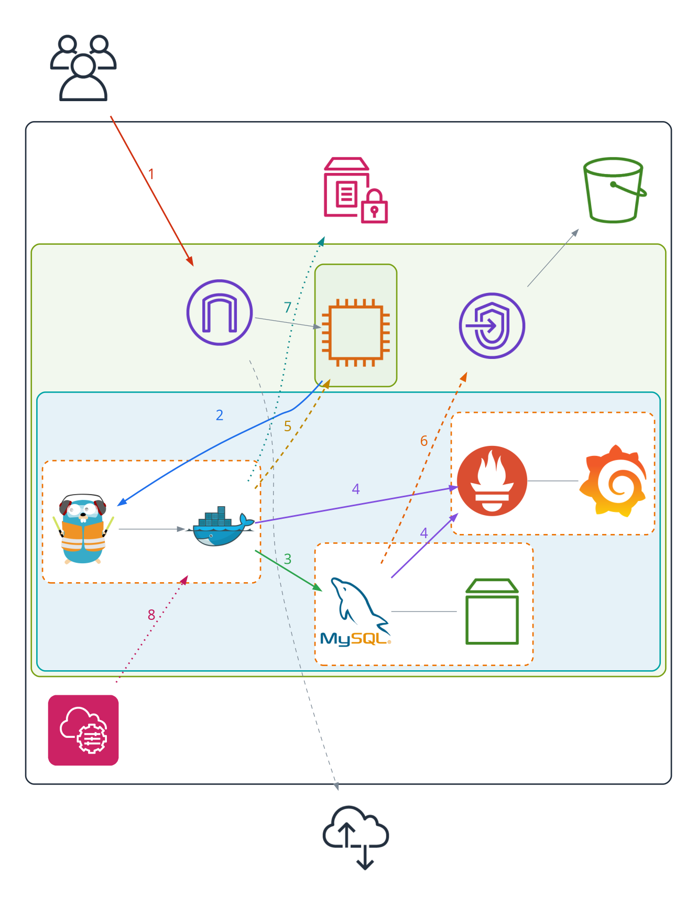
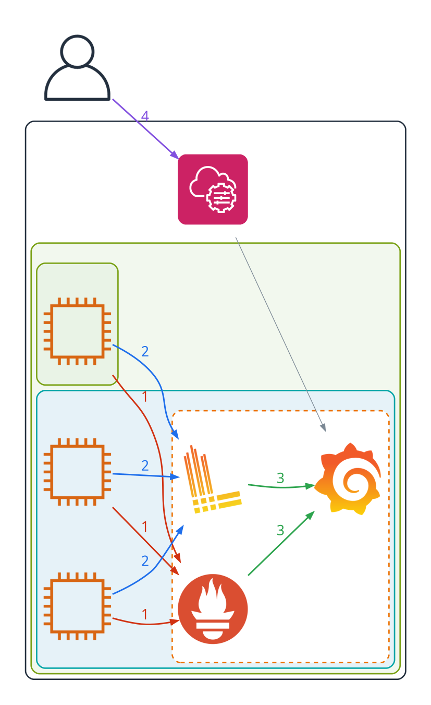
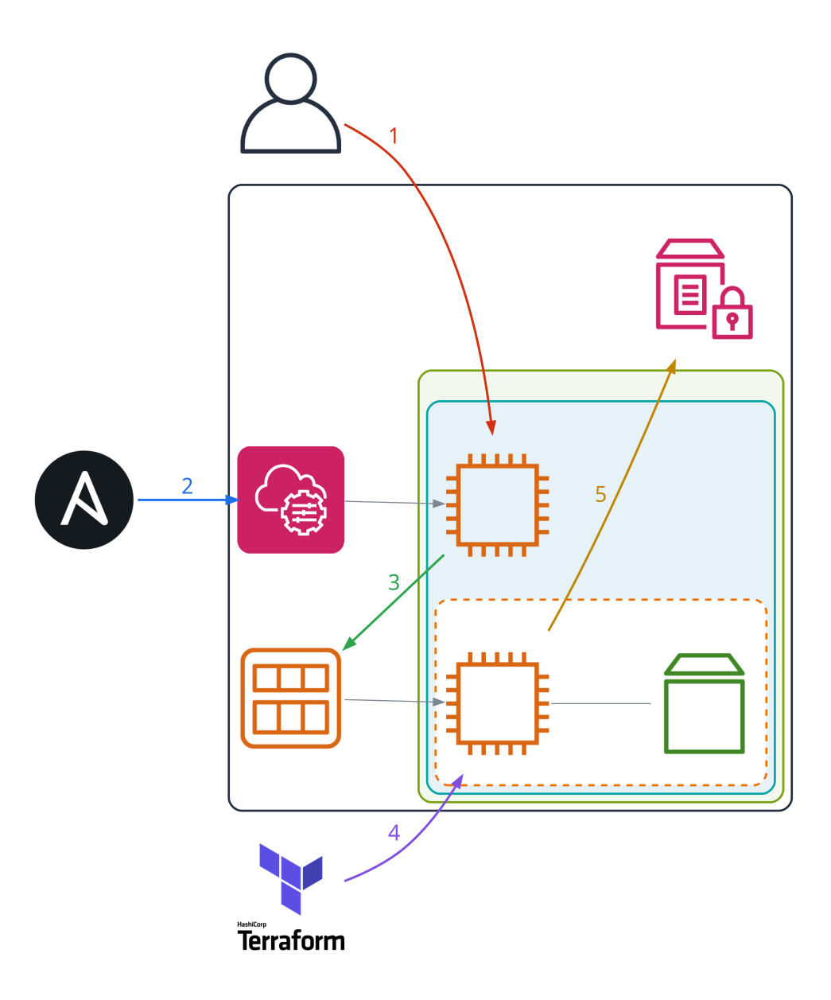

# Architecture

How BMC runs on AWS (dev; prod will copy it). The diagrams show icons and step numbers only; each number is explained in the table under its diagram. Arrows and numbers of one step share a colour.

**How to read the boxes:** dark outline = the AWS account (eu-north-1, one zone, eu-north-1a) · green = the VPC (`10.10.0.0/16`) · light green = public subnet · light blue = private subnet · dashed orange = one EC2 host and what runs on it · grey dashed = outside AWS (GitHub).

Source of the images: [`diagrams/generate.py`](diagrams/generate.py) (Python `diagrams`). Change the script, not the PNGs.

## 1. Overview

| Hosts | Address | What runs there |
|---|---|---|
| Edge (public subnet) | public IP, changes on stop/start | NAT for the private subnet; forwards 80/443 to the app host. No app code, no secrets |
| App | 10.10.1.10 | Traefik + the service containers (Docker Compose) |
| Database | 10.10.1.30 | MySQL 8.4 on its own EBS volume (kept when the host is replaced) |
| Monitoring | 10.10.1.20 | Prometheus, Loki, Grafana |

| Step | What happens |
|---|---|
| 1 | Users reach the edge host's public IP through the internet gateway. |
| 2 | The edge forwards ports 80/443 to Traefik on the app host, which routes to the services. |
| 3 | The services use MySQL on the database host (one database and user per service). |
| 4 | Every host pushes its metrics and logs to the monitoring host. |
| 5 | Private hosts reach the internet (image pulls, updates) only through the edge host's NAT. Nothing from the internet can reach them. |
| 6 | S3 traffic goes through the VPC gateway endpoint, not the internet: database backups to the backups bucket, attachments for the app. |
| 7 | Secrets live in Parameter Store, and each host may read only what it needs: the database host its own path, the app host the service database passwords (`/bmc/dev/database/users/*`), the monitoring host Grafana's password. |
| 8 | Systems Manager is the only way in: no SSH port is open anywhere. |

## 2. Infrastructure changes (this repository)

| Step | What happens |
|---|---|
| 1 | A PR is merged into `main`. |
| 2 | GitHub Actions runs lint and `terraform plan` for dev and prod. |
| 3 | The plan reads the state from the S3 state bucket. |
| 4 | A maintainer approves the apply ("Review deployments"); nothing changes in AWS without it. |
| 5 | CI signs in with the `bmc-ci` access key, which can only assume a role (STS). |
| 6 | The `bmc-admin` role, limited by a permissions boundary, runs the apply. |
| 7 | Terraform creates or changes the AWS resources. |

Manual actions (Run workflow): apply, destroy, stop, start.

## 3. Application deploy (app repository)

| Step | What happens |
|---|---|
| 1 | A PR is merged into `main` of LABDSOF_G9A. |
| 2 | Each service image is built, scanned (Trivy), signed (cosign) and pushed to GHCR as `dev-<commit>`. |
| 3 | The `bmc-deploy-dev` key may only send Run Command to the dev app host. |
| 4 | Run Command copies `compose.yaml` to the app host and runs `bmc-app-deploy <tag>`. |
| 5 | The deploy script reads the database passwords from Parameter Store. |
| 6 | The app host pulls the images from GHCR through the edge NAT and restarts the containers. |
| 7 | ZAP scans the site through the edge host's public IP (DAST). |

## 4. Metrics and logs

| Step | What happens |
|---|---|
| 1 | Grafana Alloy on every host pushes metrics to Prometheus (port 9090), including MySQL metrics. Kept 7 days. |
| 2 | Alloy pushes system and Docker logs to Loki (port 3100). Kept 7 days. |
| 3 | Grafana reads both. |
| 4 | Grafana is not public: open it with SSM port forwarding to `localhost:3000`. Password: `/bmc/dev/monitoring/grafana_admin_password`. |

## 5. Administration

| Step | What happens |
|---|---|
| 1 | A shell on any host: SSM Session Manager (`aws ssm start-session`). |
| 2 | Configuration: run Ansible (`ansible/site.yml`), hosts found by their EC2 tags. |
| 3 | For each connection Ansible pushes a temporary SSH key with EC2 Instance Connect (valid 60 s). |
| 4 | SSH runs inside the SSM session (`ansible/ssm-ssh-proxy.sh`), so no port 22 is open. |

## 6. Database image

| Step | What happens |
|---|---|
| 1 | Packer (`ami/database`) starts a temporary build host in the private subnet. |
| 2 | Ansible configures it through Session Manager (MySQL 8.4, Alloy, backup job). |
| 3 | Packer saves it as an AMI (`bmc-database-<version>`) and removes the build host. |
| 4 | Terraform starts the database host from that AMI, with the data on a separate EBS volume. |
| 5 | On every boot the host reads its passwords from Parameter Store (created by hand before the first apply, see the runbook) and creates or updates the databases and users. |

Details: [runbooks/database.md](runbooks/database.md).
